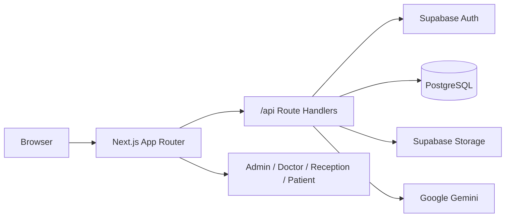

# Medical Clinic

**Clinic management platform** — appointments, patient records, consultations, PDF prescriptions, and role-based dashboards.

[](https://nextjs.org/)
[](https://react.dev/)
[](https://www.typescriptlang.org/)
[](https://supabase.com/)
[](https://tailwindcss.com/)
[](LICENSE)

Web app for a medical clinic: staff book and manage visits, doctors write consultations and prescriptions, patients book online.

---

## Features

| Role | What they can do |
| --- | --- |
| **Admin** | Clinic profile, staff invites, services, analytics |
| **Doctor** | Schedule, patients, consultations, availability, PDF prescriptions |
| **Receptionist** | Patient records, appointments, calendar, document upload |
| **Patient** | Book appointments, medical history, documents, profile |

- Supabase Auth with four roles
- Appointment booking with conflict detection and weekly doctor availability
- Consultations, medical history, and on-demand PDF prescriptions
- Medical document upload (Supabase Storage)
- In-app notifications (new / confirmed / cancelled appointments)
- Gemini-assisted time-slot suggestions
- Docker, Kubernetes, and GitHub Actions CI/CD

---

## Tech stack

| Layer | Tools |
| --- | --- |
| Frontend | Next.js 16 (App Router), React 19, TypeScript, Tailwind CSS 4, shadcn/ui |
| Forms | React Hook Form, Zod |
| Calendar | react-big-calendar |
| API | Next.js Route Handlers |
| Database & auth | Supabase (PostgreSQL, Auth, Storage) |
| AI | Google Gemini |
| PDF | jsPDF |
| DevOps | Docker, nginx, Kubernetes, GitHub Actions, GHCR |

---

## Architecture



Clinic data lives in PostgreSQL. Files go in a private Storage bucket named `medical-documents`.

---

## Getting started

**Requirements:** Node.js 20+, a [Supabase](https://supabase.com/) project. Gemini API key is optional.

```bash
git clone https://github.com/amelbenhazem/medical-clinic.git
cd medical-clinic
npm install
cp .env.example .env.local
```

Fill `.env.local`:

```env
NEXT_PUBLIC_SUPABASE_URL=https://xxxx.supabase.co
NEXT_PUBLIC_SUPABASE_ANON_KEY=your-anon-key
SUPABASE_SERVICE_ROLE_KEY=your-service-role-key
GOOGLE_GEMINI_API_KEY=your-gemini-key
```

In the Supabase SQL Editor, run [`supabase/schema.sql`](supabase/schema.sql), then create a **private** Storage bucket named `medical-documents`.

```bash
npm run dev
```

Open [http://localhost:3000](http://localhost:3000).

Never commit `.env.local`. Keep `SUPABASE_SERVICE_ROLE_KEY` on the server only.

---

## Project structure

```text
app/
  (auth)/            Login and register
  (dashboard)/       Admin, doctor, receptionist, patient UIs
  api/               REST handlers (patients, appointments, prescriptions, AI)
components/          UI, forms, calendar, notifications
lib/
  auth/              Session and roles
  supabase/          Browser and server clients
  ai/                Gemini slot suggestions
  pdf/               Prescription PDFs
supabase/schema.sql  PostgreSQL schema
k8s/                 Kubernetes manifests
.github/workflows/   Build (GHCR) and deploy
```

| Script | Purpose |
| --- | --- |
| `npm run dev` | Development server |
| `npm run build` | Production build |
| `npm run start` | Production server |
| `npm run lint` | ESLint |

```bash
cp .env.example .env
docker compose up --build
```

